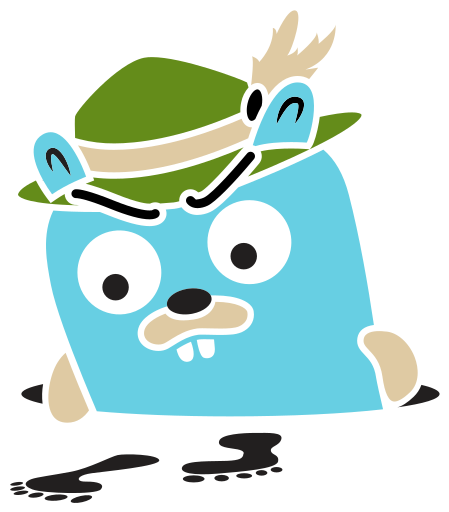
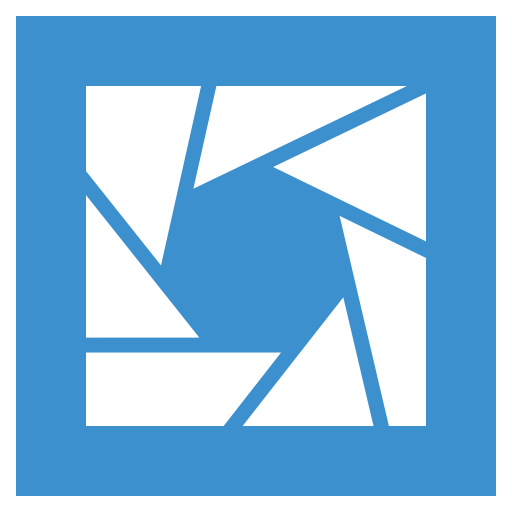
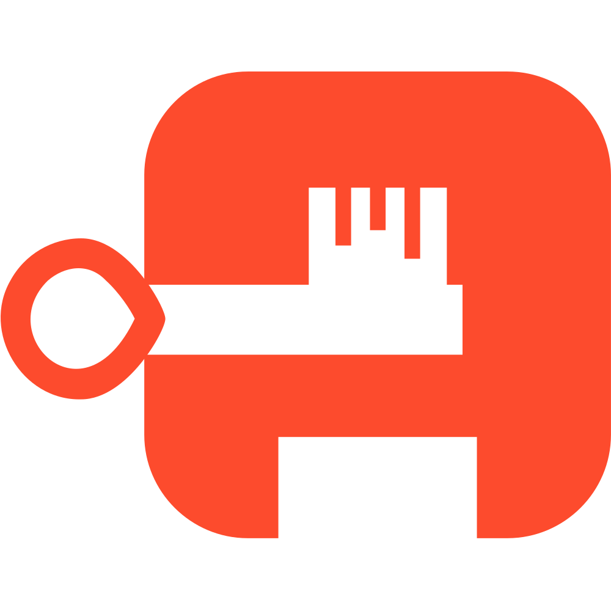
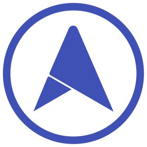
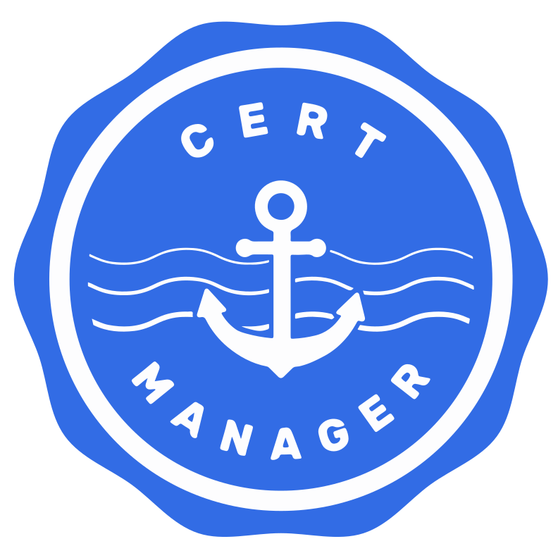
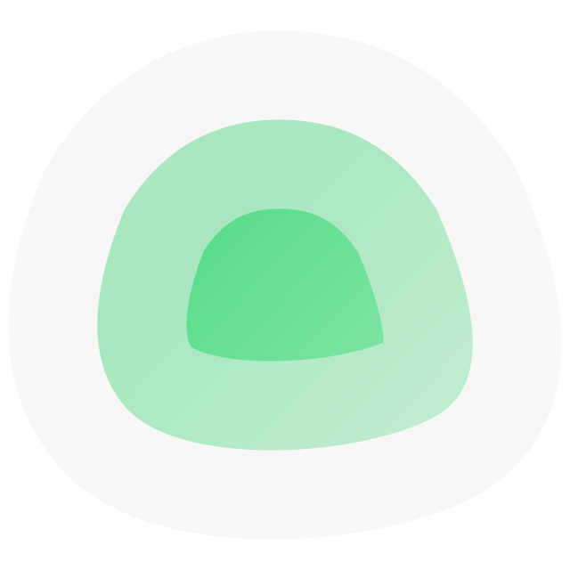
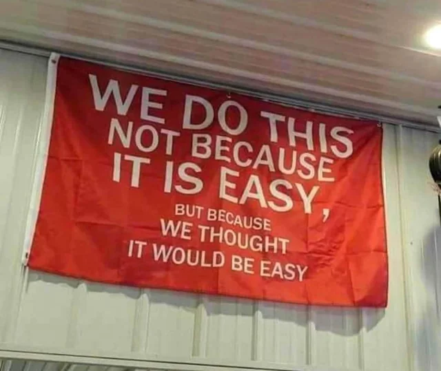

# anilsezer.net — Portfolio & Bare-Metal Kubernetes Lab

Welcome to my portfolio repository! You can explore the entire codebase and cluster configuration here, or visit the live system at **[anilsezer.net](https://anilsezer.net)**.

[](https://github.com/anil-sezer/Portfolio/actions/workflows/ci-dotnet.yml)
[](https://github.com/anil-sezer/Portfolio/actions/workflows/ci-go.yml)
[](https://github.com/anil-sezer/Portfolio/actions/workflows/ci-infra.yml)
[](https://github.com/anil-sezer/Portfolio/actions/workflows/ci-security.yml)
[](https://github.com/anil-sezer/Portfolio/actions/workflows/ci-yaml-lint.yml)
[](https://github.com/anil-sezer/Portfolio/actions/workflows/cd-portfolio.yml)
[](https://github.com/anil-sezer/Portfolio/actions/workflows/cd-crons.yml)

---

Made with love, applying **Domain-Driven Design** principles from [Eric Evans](https://ddd.academy/eric-evans/).

## What Is This?

Rather than hosting a static page on a managed cloud provider, **[anilsezer.net](https://anilsezer.net)** runs on a **6-node bare-metal Kubernetes cluster** (5 Raspberry Pi 4/5 nodes + a dedicated NAS storage server) that I built and operate at home.

The cluster runs **64+ pods**, **42+ services**, and **30+ deployments**—and the live cluster statistics shown on the website are queried directly from the Kubernetes API via the official C# [`KubernetesClient`](https://github.com/kubernetes-client/csharp).

- **Single-Command Node & Cluster Setup:** Nodes are provisioned, hardened, and joined using Ansible ([`ansible-prepare-k8s-cluster/`](./ansible-prepare-k8s-cluster)).
- **Bare-Metal Networking & TLS:** [MetalLB](https://metallb.io/) for Layer 2 load balancing, [Traefik](https://traefik.io/traefik) as the Ingress controller, and [Let's Encrypt](https://letsencrypt.org/) (`cert-manager`) for automated TLS certificates.
- **Polyglot Microservices over gRPC:** A `.NET 10` Blazor frontend communicates with a `.NET 10` gRPC backend and `Go` CronJobs using shared Protocol Buffer contracts ([`protos/`](./protos)).
- **Full Self-Hosted Observability:** Instrumented end-to-end with OpenTelemetry, Prometheus, Grafana, Jaeger (backed by Elasticsearch), and Seq, with internal dashboards protected by Authentik SSO.
- **Automated CI/CD with In-Cluster Runner:** Hybrid GitHub Actions pipelines executing automated testing, linting, security audits, and multi-arch container builds paired with a sandboxed in-cluster self-hosted runner on Raspberry Pi hardware for continuous deployment.

---

## Tech Stack

|  <br/> **Kubernetes** |  <br/> **Ansible** |  <br/> **Docker** |  <br/> **.NET 10 & Blazor** |
|:---:|:---:|:---:|:---:|
|  <br/> **Go** |  <br/> **gRPC** |  <br/> **PostgreSQL** |  <br/> **OpenTelemetry** |
|  <br/> **Prometheus & Alertmanager** |  <br/> **Grafana** |  <br/> **Jaeger** |  <br/> **Seq** |
|  <br/> **Lens** |  <br/> **Kubecolor** |  <br/> **Elasticsearch** |  <br/> **Authentik** |
|  <br/> **Traefik** |  <br/> **Helm** |  <br/> **MetalLB** |  <br/> **Cert-Manager** |
|  <br/> **Flannel** |  <br/> **Containerd** |  <br/> **Uptime Kuma** |  <br/> **Kibana** |
|  <br/> **Admin Neo** |  <br/> **GitHub Actions** | | |

1. **`Kubernetes:`** After setting up this bare-metal cluster on my own, I learned that doing it from scratch is famously known as [Kubernetes The Hard Way](https://github.com/kelseyhightower/kubernetes-the-hard-way). All 5 Raspberry Pi nodes and the NAS storage server are prepared and deployed with a **single Ansible command**.
2. **`Ansible:`** I felt this Kubernetes setup would be incomplete without full automation. It also encourages experimentation—if I break the lab beyond repair while testing something new, I can reset and reprovision the entire cluster rapidly.
3. **`Docker:`** Every service is containerized and compiled for multi-arch (`linux/arm64` & `linux/amd64`). Public images are on [my DockerHub](https://hub.docker.com/repositories/anilsezer), while private images run from a self-hosted Docker private image registry inside the cluster.
4. **`.NET 10 & Blazor:`** Built with Domain-Driven Design (DDD) and Clean Architecture using the latest `.NET 10` and Blazor features, complete with bilingual (EN/TR) localization and unit/integration test suites.
5. **`Go:`** Whenever a scheduled job needs more than plain YAML, I write it in Go—both to keep cron workloads lightweight and to broaden my perspective across languages.
6. **`gRPC:`** Wanted to move beyond standard REST for internal service-to-service communication. Both the Blazor UI and the Go CronJobs talk to the backend over gRPC.
7. **`PostgreSQL:`** Primary database for the cluster (running on persistent NFS storage backed by automated `pg_dump` cron backups). I enjoy its feature set and love experimenting with it.
8. **`OpenTelemetry:`** Distributed traces across services are a must.
9. **`Prometheus & Alertmanager:`** Used for 4+ years alongside Alertmanager to collect metrics, monitor cluster health, and handle critical alerts.
10. **`Grafana:`** This cluster wouldn't be complete without the mesmerizing dashboards of Grafana.
11. **`Jaeger:`** Distributed tracing platform used for inspecting request lifecycles and traces across gRPC microservices and web clients.
12. **`Seq:`** Structured log ingestion correlated with trace IDs—has a clean, fast UI.
13. **`Lens:`** Provides a graphical overview of the cluster to inspect workloads, events, and pod logs in real time.
14. **`Kubecolor:`** A must-have CLI tool that colorizes all `kubectl` outputs and pod logs in the terminal.
15. **`Elasticsearch:`** Storage backend for Jaeger distributed traces and cluster log analysis.
16. **`Authentik:`** Secures access to internal cluster dashboards and admin panels via Forward-Auth SSO.
17. **`Traefik:`** Handles all reverse proxy routing, SSL termination, and Forward-Auth middleware for Authentik across the cluster.
18. **`Helm:`** Essential for templating and managing lifecycle releases of Traefik, Grafana, Authentik, and observability stacks.
19. **`MetalLB:`** Brings bare-metal Layer 2 load balancing to my Raspberry Pi cluster, assigning dedicated VIPs to ingress services.
20. **`Cert-Manager:`** Automates issuing and renewing Let's Encrypt SSL/TLS certificates for all custom domains and panel subdomains.
21. **`Flannel:`** Simple and rock-solid VXLAN overlay network connecting all 5 physical Raspberry Pi nodes seamlessly.
22. **`Containerd:`** Industry-standard container runtime running underneath Kubernetes on every node, configured via Ansible.
23. **`Uptime Kuma:`** Self-hosted status page and health monitoring watching over my sites, APIs, and cluster endpoints.
24. **`Kibana:`** Used alongside Elasticsearch to visualize, search, and analyze cluster and application log streams.
25. **`Admin Neo:`** Lightweight, sleek web management GUI for inspecting and maintaining my PostgreSQL databases.
26. **`GitHub Actions:`** Drives all CI/CD workflows, automated testing, and multi-arch image compilation paired with an in-cluster self-hosted runner for automated deployments.

---

## Repository Structure

```text
Portfolio/
├── .github/                       # CI/CD workflows, test summary scripts & actions
├── ansible-prepare-k8s-cluster/   # Ansible playbooks for bare-metal node setup, containerd, kubeadm & MetalLB
├── kubernetes/                    # Kubernetes manifests & Helm values for the entire cluster
│   ├── website/                   # Frontend (Blazor) & Backend (gRPC) deployments, services, RBAC & Ingress
│   ├── crons/                     # Go & Bash CronJobs (Bing daily wallpaper, IP geolocation, DB backups)
│   ├── observability/             # OpenTelemetry, Prometheus, Grafana, Jaeger & Seq configurations
│   ├── traefik-ingress/           # Traefik v3 ingress controller, TLS certificates & middlewares
│   ├── authentik/                 # Authentik SSO & forward-auth middleware
│   ├── db/                        # PostgreSQL, Redis, Elasticsearch & Admin Neo manifests
│   ├── github-runner/             # In-cluster self-hosted GitHub Actions runner for continuous deployment
│   ├── uptime/                    # Uptime Kuma monitoring & status page manifests
│   └── image-registry/            # Self-hosted Docker private image registry
├── protos/                        # Shared gRPC Protocol Buffer contracts (used by both C# and Go)
├── src/
│   ├── Portfolio.Domain/          # Pure DDD domain entities, enums & interfaces
│   ├── Portfolio.Infrastructure/  # EF Core (PostgreSQL), OpenTelemetry, KubernetesClient & Telegram notifications
│   ├── Portfolio.Grpc/            # .NET 10 gRPC backend service & async Channel background workers
│   └── Portfolio.Ui/              # .NET 10 Blazor web application (EN/TR)
└── tests/
    └── Portfolio.Test.*/          # Unit & integration test suites (Domain, Grpc, Infrastructure, UI)
```

---

## Credits

- **Daily background images:** [Bing Daily Wallpapers](https://www.microsoft.com/en-us/bing/bing-wallpaper) (fetched daily by a Go CronJob)
- **Contact map tiles:** [Leaflet Provider Previews](https://leaflet-extras.github.io/leaflet-providers/preview/)
- **Tech stack section gradient:** [Post Wook](https://x.com/POSTWOOK/status/2097037189049925818)

---

Setting up and properly managing a Kubernetes cluster on bare metal was hard when I set this up years ago. Now, I'm quite comfy with it.


